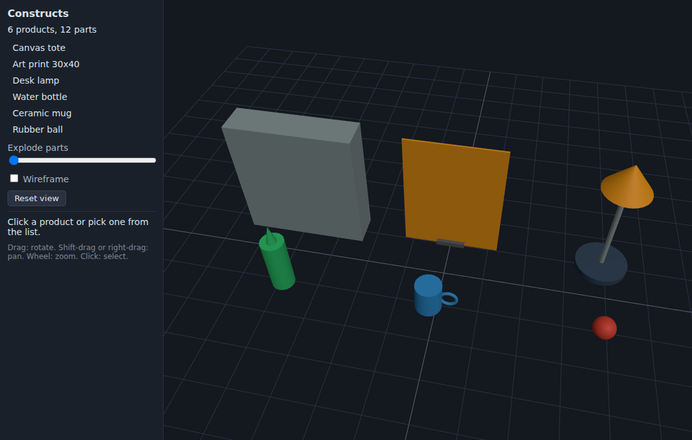

# construct3d

Turn a product list into **one HTML file** that shows every product as a 3D model you can orbit, select and "explode" into its parts. No server, no build step, no network at view time: three.js is bundled inside the file.

- Input: JSON or CSV with a name and a width / depth / height per product (or a list of parts for a real assembly).
- Output: `constructs.html` (about 690 KB, double-click to open) and, optionally, the scene as JSON.
- Python 3.9+, **standard library only**. The viewer bundles three.js r170 (MIT, `construct3d/vendor/`).
- The shapes are **stand-ins built from primitives** (box, cylinder, cone, sphere, torus), not photo-real models. A name or category keyword (mug, bottle, poster, ball, ...) picks a rough preset; anything else is a box of the given size. For a real assembly, give the parts yourself.



*A real render of `python -m construct3d build examples/products.json` in headless Chromium (software WebGL), default camera. The orbit, click-to-select, explode slider and wireframe toggle were not exercised by an automated browser test; the scene they act on is checked as described under "How it is checked".*

## Quickstart

```bash
git clone https://github.com/MegaStretch23/construct3d.git
cd construct3d

python -m construct3d sample > products.json                 # six invented products
python -m construct3d inspect products.json                  # sizes and layout as a table
python -m construct3d build products.json -o constructs.html # then open constructs.html in a browser
```

`pip install .` also gives a `construct3d` command. The viewer needs a browser with WebGL.

Real output of `python -m construct3d inspect examples/products.json` (saved in `examples/inspect.txt`):

```text
id               W x D x H (cm)   parts  source         at (x, z)
---------------  ---------------  -----  -------------  ---------------
canvas-tote      38 x 10 x 40     1      preset:box     (-47.5, -12.75)
art-print-30x40  30 x 3 x 40      2      preset:poster  (0, -12.75)
desk-lamp        16 x 16 x 41     4      parts          (47.5, -12.75)
water-bottle     7 x 7 x 24       2      preset:bottle  (-47.5, 12.75)
ceramic-mug      12.75 x 8 x 9.5  2      preset:mug     (0, 12.75)
rubber-ball      6.5 x 6.5 x 6.5  1      preset:ball    (47.5, 12.75)
6 products, 12 parts; scene bounds [-66.5, 0.0, -20.75] .. [55.5, 41.0, 16.75] cm
```

The mug is 12.75 wide because its handle is counted: you gave the body (8 x 8 x 9.5), the table reports the whole construct.

## Input

CSV (`examples/products.csv`) or JSON. Columns / keys: `name` (required), `width`, `depth`, `height` (required unless `parts` is given), and optional `category`, `color` (`#rrggbb`), `shape` (`box`, `cylinder`, `sphere`), `price` (shown as text), `url` (must be http/https, shown as a link in the info panel).

```json
{"name": "Desk lamp", "price": "$31.00", "parts": [
  {"name": "base", "shape": "cylinder", "size": [8, 2],  "pos": [0, 1, 0],    "color": "#2c3e50"},
  {"name": "arm",  "shape": "cylinder", "size": [0.8, 30], "pos": [0, 17, 0], "color": "#7f8c8d"},
  {"name": "shade", "shape": "cone",    "size": [7, 9],  "pos": [0, 36.5, 0], "color": "#d68910", "rot": [0, 0, 0]}]}
```

| shape | `size` | notes |
|---|---|---|
| box | `[width x, height y, depth z]` | |
| cylinder, cone | `[radius, height]` | axis is y |
| sphere | `[radius]` | |
| torus | `[ring radius, tube radius]` | lies in the XY plane |

`pos` is the part centre, `rot` is `[rx, ry, rz]` in degrees (three.js XYZ order). Y is up. Every product is dropped onto the floor and centred, then products are laid out on a grid. Options: `--unit cm|mm|m|in` (unit of your input), `--title`, `--gap`, `--cols`, `--json scene.json`. Bad input (missing name, zero or non-numeric size, unknown shape, non-http url) exits 1 with a one-line message.

## The viewer

Drag to rotate, shift-drag or right-drag to pan, wheel to zoom, click a product (or pick it in the list) to select it and read its size, parts, price and link. The **Explode** slider moves each part away from the product's centre. Product names and URLs are put in the page as text, never as markup (there is a test for a name like `</script>`).

## How it is checked

```bash
pip install pytest
python -m pytest        # 17 tests
python -m construct3d selftest
```

The tests cover validation, units, CSV, presets, layout overlap, the HTML escaping, the self-contained page and the CLI exit codes. One class runs the viewer's own `buildScene()` with three.js in **Node** and compares every product's world bounding box with the Python bounds, including parts rotated on all three axes (skipped when `node` is not installed). The saved run is `examples/parity.txt`:

```text
canvas-tote        python vs three.js max difference 0.000000 cm
art-print-30x40    python vs three.js max difference 0.000000 cm
desk-lamp          python vs three.js max difference 0.000000 cm
water-bottle       python vs three.js max difference 0.000000 cm
ceramic-mug        python vs three.js max difference 0.000000 cm
rubber-ball        python vs three.js max difference 0.000000 cm
6 items, worst difference 0.000000 cm
```

Every file in `examples/` is produced by `sh examples/regenerate.sh` (set `PY=python3` if there is no `python`).

## Limits

- Stand-in shapes only: no meshes (STL / glTF / OBJ) are read, and the presets are rough heuristics, not product-accurate models.
- At most 500 products per scene, lengths up to 10000 cm.
- It does not fetch product data. Bring your own list.

## Also by the author

If you need the product data itself, I run pay-per-event tools on Apify, for example the [SEC Form 4 insider cluster scanner](https://apify.com/johnveds15/sec-form4-insider-clusters): $0.0004 per Form 4 filing parsed and $0.02 per insider cluster detected (price read from the Apify API on 2026-11-13). It is unrelated to 3D; there is no paid version of construct3d.

MIT licensed. three.js is MIT, copyright 2010-2024 three.js authors (`construct3d/vendor/LICENSE-three.txt`).

## Merged from constructs-3d

`constructs-3d` was the same idea built twice. Its own files are kept in [`merged/constructs-3d/`](merged/constructs-3d/) (unique parts: see that folder's README and tests); the old repo now points here: https://github.com/MegaStretch23/constructs-3d

## Merged from constructs-3d-viewer

`constructs-3d-viewer` was the same idea built twice. Its own files are kept in [`merged/constructs-3d-viewer/`](merged/constructs-3d-viewer/) (unique parts: see that folder's README and tests); the old repo now points here: https://github.com/MegaStretch23/constructs-3d-viewer
